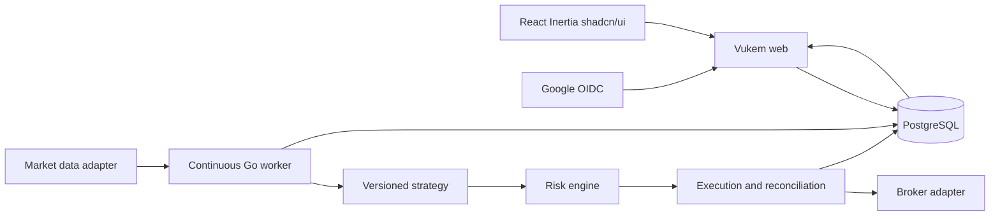

# Proposed architecture

> Implementation update: see the [ROADMAP](../ROADMAP.md),
> [ADR-0011](adrs/0011-autonomous-implementation.md),
> [ADR-0012](adrs/0012-transactional-snapshots.md) and
> [ADR-0013](adrs/0013-polling-workers-and-deploy.md) for the effective state.
> The text below preserves the original requirements/designs, not a statement that
> all infrastructure or external validation details have already occurred.

Status: proposal subject to product decisions. References: ADR-0002 to 0006.

## Components and responsibilities

The engine does not live in a goroutine started by a request, browser tab or
ephemeral function. Proposed processes: `cmd/app` for the web and `cmd/engine` for the
worker, both with shared domain packages. A single process per account
is an initial simplification, not a guarantee of exclusivity: use lock and fencing.

| Suggested module | Responsibility |
| --- | --- |
| `app/accounts` | Google identity, sessions and authorization |
| `internal/trading/marketdata` | Events, candles, gaps, calendars |
| `internal/trading/strategy` | Deterministic evaluation and versioned DSL |
| `internal/trading/risk` | Limits, reservations, blocks and decision |
| `internal/trading/execution` | Intents, sending, states and reconciliation |
| `internal/trading/portfolio` | Fills, positions, cash and metrics |
| `internal/trading/backtest` | Replay, fill simulation and reports |
| `internal/adapters` | Feed/broker, clock and storage |

These directories do not exist yet. Interfaces must be born from the contracts of the
SDDs, without copying external APIs into the domain.

## Durable flow

1. Validate event (origin, time, sequence, integrity) and persist candle.
2. Evaluate only closed candles, with strategy version and parameters.
3. Generate a signal identified deterministically per run/candle/strategy.
4. In a transaction, validate limits and reserve the account's exposure, including pending orders; record the decision, intent and outbox with uniqueness.
5. Executor claims work with lock/fencing, persists the start of sending and checks the relevant state
   before calling the broker. A communication failure may leave the intent in `unknown`; do not resend indiscriminately.
6. Persist confirmations and idempotent fills; apply accounting and release
   reservations only when the state justifies it. Publish the update to the web.

There is no atomic transaction between PostgreSQL and the broker. The goal is to record the intent
once and reconcile external effects; do not claim external execution exactly
once. Even `client_order_id` requires verifying the semantics and uniqueness of the adapter.

## Exclusivity, recovery and blocking

Serialize risk decisions per account with transaction/lock and a generation token.
The executor validates the generation and block state immediately before sending.
A leadership change closes the path for new orders until orders and
positions are reconciled. An external request already in flight is not cancelled by the database lock:
reconcile its effects, and record this limit in the kill switch.

Database failure, stale feed, divergent position or indeterminate exposure
block new entries. Risk-reducing exits follow their own policy,
with recent observation and protection against reversing a position. On boot, reconcile
open orders, recent fills, cash and positions before the `ready` state.

## Dashboard update

Proposed: authenticated snapshots and SSE for events, with polling as fallback.
Choose WebSocket only if bidirectional interaction justifies it. Events have
a cursor; on reconnection, query the current state. If the cursor expired, send a
full snapshot. The dashboard does not calculate the official balance nor keep the process alive.

## Security boundaries

The web does not receive broker secrets in the frontend. Execution credentials only in the
worker; Google callbacks belong to the web. Each query must filter account and
permission on the backend. Q1 confirmed personal use: each access must belong to the authorized Google account;
opaque IDs do not replace authorization. Feed and broker are separate adapters.

## Brazil and US — confirmed scope

Separate `market`, `venue`, currency and calendar from the symbol. A `BrokerAdapter`
resolves orders and account; a `MarketDataAdapter` resolves feed/history, and may be
another provider. Do not use symbols from one exchange in another exchange's adapter. Proposal:
independent paper executions/accounts per market; shared risk engine
as code, with policies and reservations scoped to each account. Global consolidation
requires FX and an explicit policy, still pending. B3 will have at least backtest/paper;
the internal simulator is confirmed in Q5. Alpaca Paper is confirmed for the US in Q4.

## Confirmed mode contracts

`mode=paper_broker` sends only to the Alpaca Paper adapter. `mode=simulation`
executes internal B3 fills; the clock origin (`historical_replay` or `realtime`)
is a separate field. `mode=backtest` is an isolated historical experiment. Q8 will decide whether
B3 starts with replay only. Never rename replay to real time. All use
segregated identifiers/ledgers to prevent mixing balances/results.
