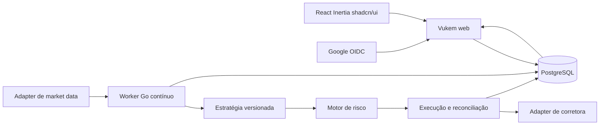

# Arquitetura proposta

> Atualização de implementação: consulte o [ROADMAP](../ROADMAP.md),
> [ADR-0011](adrs/0011-implementacao-autonoma.md),
> [ADR-0012](adrs/0012-snapshots-transacionais.md) e
> [ADR-0013](adrs/0013-workers-polling-e-deploy.md) para o estado efetivo.
> O texto abaixo preserva requisitos/desenhos originais, não uma declaração de
> que todos os detalhes de infraestrutura ou validação externa já ocorreram.

Estado: proposta sujeita às decisões de produto. Referências: ADR-0002 a 0006.

## Componentes e responsabilidades

A engine não vive em uma goroutine iniciada por request, aba de navegador ou
função efêmera. Proposta de processos: `cmd/app` para web e `cmd/engine` para
worker, ambos com pacotes de domínio compartilhados. Um processo único por conta
é simplificação inicial, não garantia de exclusividade: usar lock e fencing.

| Módulo sugerido | Responsabilidade |
| --- | --- |
| `app/accounts` | Identidade Google, sessões e autorização |
| `internal/trading/marketdata` | Eventos, candles, gaps, calendários |
| `internal/trading/strategy` | Avaliação determinística e DSL versionada |
| `internal/trading/risk` | Limites, reservas, bloqueios e decisão |
| `internal/trading/execution` | Intenções, envio, estados e reconciliação |
| `internal/trading/portfolio` | Fills, posições, caixa e métricas |
| `internal/trading/backtest` | Replay, simulação de fills e relatórios |
| `internal/adapters` | Feed/corretora, relógio e armazenamento |

Esses diretórios ainda não existem. Interfaces devem nascer dos contratos dos
SDDs, sem copiar APIs externas para o domínio.

## Fluxo durável

1. Validar evento (origem, horário, sequência, integridade) e persistir candle.
2. Avaliar apenas candle encerrado, com versão da estratégia e parâmetros.
3. Gerar sinal identificado de modo determinístico por execução/candle/estratégia.
4. Em transação, validar limites e reservar exposição da conta, inclusive ordens
   pendentes; gravar decisão, intenção e outbox com unicidade.
5. Executor reclama trabalho com lock/fencing, persiste início de envio e consulta
   estado relevante antes de chamar a corretora. Falha de comunicação pode deixar
   a intenção em `unknown`; não reenviar indiscriminadamente.
6. Persistir confirmações e fills idempotentes; aplicar contabilidade e liberar
   reservas apenas quando o estado justificar. Publicar atualização para a web.

Não há transação atômica entre PostgreSQL e corretora. A meta é registrar intenção
uma vez e reconciliar efeitos externos; não afirmar execução externa exatamente
uma vez. Mesmo `client_order_id` exige verificar semântica e unicidade do adapter.

## Exclusividade, recuperação e bloqueio

Serializar decisões de risco por conta com transação/lock e token de geração.
O executor valida geração e estado de bloqueio imediatamente antes do envio.
Mudança de liderança fecha o caminho de novas ordens até reconciliar ordens e
posições. Um request externo já em voo não é cancelado pelo lock do banco:
reconciliar seus efeitos, e registrar esse limite no kill switch.

Falha no banco, feed vencido, posição divergente ou exposição indeterminada
bloqueiam novas entradas. Saídas de redução de risco seguem política própria,
com observação recente e proteção contra inverter posição. No boot, reconciliar
ordens abertas, fills recentes, caixa e posições antes de estado `ready`.

## Atualização do dashboard

Proposta: snapshots autenticados e SSE para eventos, com polling como fallback.
Escolher WebSocket apenas se a interação bidirecional justificar. Eventos têm
cursor; reconectar consulta estado atual. Se o cursor expirou, enviar snapshot
completo. O dashboard não calcula o saldo oficial nem mantém o processo vivo.

## Fronteiras de segurança

Web não recebe segredo de corretora no frontend. Credenciais de execução só no
worker; callbacks Google pertencem à web. Cada consulta deve filtrar conta e
permissão no backend. Q1 confirmou uso pessoal: cada acesso deve pertencer à conta Google autorizada;
IDs opacos não substituem autorização. Feed e broker são adapters separados.

## Brasil e EUA — escopo confirmado

Separar `market`, `venue`, moeda e calendário do símbolo. Um `BrokerAdapter`
resolve ordens e conta; um `MarketDataAdapter` resolve feed/histórico, podendo ser
outro fornecedor. Não usar símbolos de uma bolsa em adapter de outra. Proposta:
execuções/contas paper independentes por mercado; motor de risco compartilhado
como código, políticas e reservas no escopo de cada conta. Consolidação global
exige FX e política explícita, ainda pendentes. B3 terá ao menos backtest/paper;
simulador interno está confirmado em Q5. Alpaca Paper está confirmada aos EUA em Q4.

## Contratos dos modos confirmados

`mode=paper_broker` envia somente ao adapter Alpaca Paper. `mode=simulation`
executa fills internos B3; a origem do relógio (`historical_replay` ou `realtime`)
é campo separado. `mode=backtest` é experimento histórico isolado. Q8 decidirá se
B3 começa apenas com replay. Nunca renomear replay para tempo real. Todos usam
identificadores/ledger segregados para impedir mistura de saldos/resultados.
