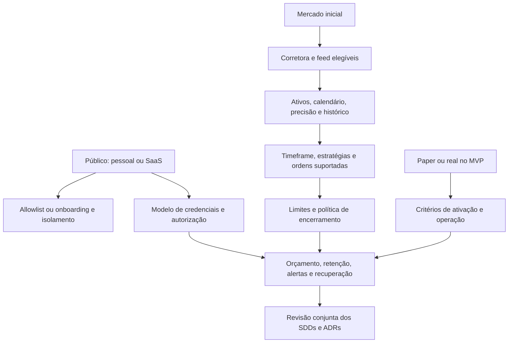

# Grilling — árvore de decisões

Estado: rodadas 1 e 2 respondidas; Q7–Q9 não foram respondidas individualmente.
A instrução posterior de implementar tudo sem interrupções delegou escolhas de
implementação. Defaults adotados estão no ADR-0011 e no ROADMAP; não são respostas
inventadas do proprietário. A implementação começou com essa autorização. Nenhuma opção pré-selecionada é aceite. O documento continua em rascunho até haver entendimento compartilhado.

## Método

Perguntar apenas decisões cujos pré-requisitos estejam resolvidos. Dar uma
recomendação e formular a pergunta para que "sim" a aceite. Fatos de ferramentas,
código e provedores são pesquisados, não delegados ao usuário. Não implementar
escolhas ainda abertas; documentação solicitada pode avançar com estados claros.

## Decisões já estabelecidas

Go/Vukem + Inertia/React/Tailwind/PostgreSQL; `/` como dashboard; Google como
único login; visitante vai para `/login`; sidebar shadcn/ui; Railway.

## Rodada 1 — respondida

**Q1 — Público:** podemos começar como terminal pessoal, restrito à conta Google
do proprietário? Recomendação: sim, pessoal no MVP. Alternativa: SaaS desde o
início. Resposta: **uso pessoal confirmado**.

**Q2 — Mercado:** podemos começar apenas com ações americanas? Recomendação:
sim, um mercado. Alternativas: B3, cripto, Brasil + EUA. Resposta: **Brasil e EUA confirmados**.

**Q3 — Modo:** podemos começar só com backtesting e paper trading? Recomendação:
sim; real fica em fase posterior. Resposta: **backtesting e paper confirmados**.

## Árvore de dependências

## Rodada 2 — respondida

**Q4 — EUA:** podemos usar Alpaca Paper como primeira integração, com adapter
substituível? Recomendação: sim. Alternativas: IBKR ou escolher depois.
Resposta: **Alpaca Paper confirmado para EUA**.

**Q5 — B3:** podemos começar com backtest e simulador interno e conectar paper
externo depois de comprovar uma API? Recomendação: sim. Alternativa: exigir
integração com corretora B3 no MVP. Resposta: **simulador interno B3 confirmado**.

**Q6 — Acesso:** podemos permitir uma conta Google, autorizada inicialmente por
email verificado e depois vinculada ao subject estável? Recomendação: sim,
sem cadastro público. Alternativa: outras contas por convite. Resposta: **uma conta Google autorizada confirmada**.

Simulador interno usa dinheiro fictício e modelo próprio de fills; não pode ser
rotulado como execução em corretora. Fonte de dados B3 continua em aberto mesmo
com o simulador interno já aceito em Q5.

## Rodada 3 — fronteira atual

**Q7 — Ativos:** podemos começar com ações à vista, long-only sem alavancagem,
watchlist PETR4, VALE3, ITUB4, AAPL, NVDA e TSLA? Recomendação: sim, configurável;
opções, futuros e cripto fora do MVP. Resposta: **pendente**.

**Q8 — Dados:** podemos usar IEX/Alpaca nos EUA e importar candles históricos B3
via CSV com procedência/licença? B3 inicialmente replay histórico; tempo real
exige fornecedor próprio. Recomendação: sim. Resposta: **pendente**.

**Q9 — Tempo:** podemos usar candles fechados de 5 minutos, sessão regular e
encerramento planejado antes do fechamento? Recomendação: sim, respeitando os
calendários dos dois mercados. Resposta: **pendente**.

## Rodadas seguintes, ainda não enviadas

Depois de Q1: proprietário autorizado por identidade, convites, recuperação,
isolamento por conta, perfis de acesso e eventual monetização.
Depois de Q2: corretora, dados disponíveis, orçamento do feed, universo de ativos,
moeda e sessões. Só depois: estratégias, frequências e tipos de ordem.
Depois de Q3: definição de paper, necessidade de broker externo, gates de live,
reconciliação, supervisão e bloqueios de risco.
Depois dessas escolhas: limites numéricos, sem overnight, encerramento de sessão,
tratamento de desconexões, alertas e autoridade para retomar.
Por fim: retenção, RPO/RTO, disponibilidade, orçamento Railway, cronograma e
aceite do plano de implementação.

## Registro de respostas

| Rodada | Decisão | Resposta | Impacto |
| --- | --- | --- | --- |
| 1 | Público | Pessoal | Sem SaaS no MVP; autorização do proprietário obrigatória |
| 1 | Mercado | Brasil + EUA | Dois calendários/moedas; adapters definidos na rodada 2 |
| 1 | Execução | Backtest + paper | Capital real fora do MVP |
| 2 | Corretora EUA | Alpaca Paper | Adapter externo paper confirmado |
| 2 | Simulação B3 | Interna inicialmente | Não prometer ordens externas B3 |
| 2 | Admissão Google | Uma conta autorizada | Email verificado de bootstrap + subject estável |
| 3 | Universo e direção | Pendente | Precisão, capacidades e exposição |
| 3 | Feeds e histórico | Pendente | IEX e CSV B3 são propostas |
| 3 | Frequência/sessão | Pendente | Estratégias e calendários |

A entrevista ainda não terminou. Datas em documentos não substituem aceites.
