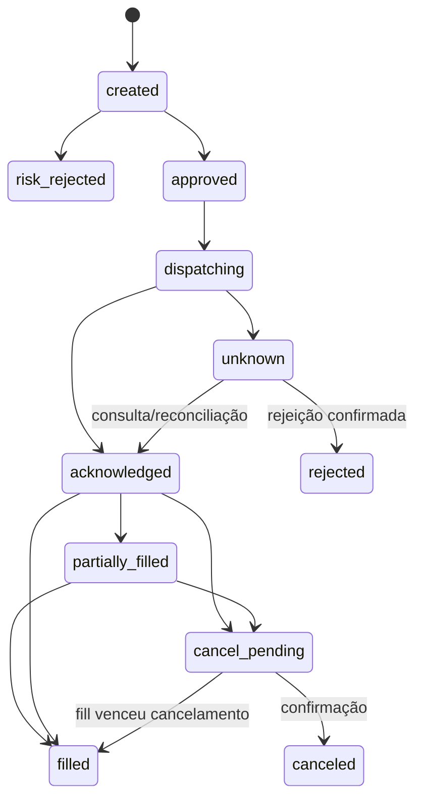

# SDD-03 — risco, execução e reconciliação

> Implementação atual e desvios explícitos em [ROADMAP](../../ROADMAP.md)
> e [ADRs 0011–0013](../adrs/README.md). Aceite técnico local é distinto
> de OAuth/broker reais, publicação Railway e observação financeira prolongada.

Estado: execução apenas paper confirmada; desenho proposto, limites numéricos e tipos de ordem pendentes.

## Invariantes

Toda intenção passa pelo risco; inclusive controles administrativos futuros.
Somar exposição executada, parcial, reservada e ambígua. Posição/cash vêm de
fills reconciliados e snapshots identificados. Não criar nova exposição se conta,
feed, calendário ou estado de ordem não forem confiáveis. Nunca permitir saldo
fictício do backtest como saldo de uma conta paper/live.

## Política de risco

Versão inclui risco por operação, perda diária, exposição total/ativo, número de
posições/ordens, limite de volume/liquidez, idade máxima de preço, sessão,
slippage e regra de encerramento. Valores iniciais não estão aprovados.
Perda diária: definir equity-base e inclusão de P&L não realizado na rodada de
risco; recomendação conservadora é incluir ambos e custos, sem reset por restart.
Risco é recalculado dentro da transação que cria reserva/intenção/outbox.

Long-only, sem leverage e ordens limitadas são candidatas, não decisões. Saídas
exigem política própria: não rejeitar redução de risco só por limite de novas
entradas; também não permitir saída duplicada abrir posição inversa.

## Estados

Estados internos propostos: `created`, `risk_rejected`, `approved`, `dispatching`,
`unknown`, `acknowledged`, `partially_filled`, `filled`, `cancel_pending`,
`canceled`, `rejected`, `expired`. Fill parcial pode coexistir com cancelamento;
modelar quantidade executada separada do status. Adapter mapeia estados externos
sem perder seu valor original. Eventos fora de ordem não fazem regressão cega.

Diagrama não esgota todos os estados; rejeição/expiração são possíveis segundo
contrato do broker. Ausência de ordem em uma consulta não prova rejeição imediata:
considerar atraso e consistência do provedor, manter quarentena e reconciliar.

## Idempotência e reconciliação

Gerar chave única por conta, estratégia, versão, sinal e ação. Persistir
`client_order_id` antes da chamada externa. Após timeout, buscar por esse ID e
ordens/fills antes de qualquer retry. Não gerar ID novo para o mesmo envio.
O adapter deve declarar o que acontece quando um ID é reapresentado e por quanto
tempo a consulta é confiável. Sem prova suficiente, manter `unknown` e bloquear.

Ingestão de execução via stream + reconciliação periódica/API; cursor persistente
e overlap deduplicado. Fonte externa confirma ordens/posições; ledger local
preserva trilha. Divergência gera incidente e bloqueio até resolução registrada.

## Emergência

`halt_new_orders` persiste bloqueio e incrementa geração; não depende da engine
estar saudável para gravar. `cancel_open_orders` acompanha respostas e fills em
voo. `flatten_positions` é comando separado com confirmação explícita, observação
recente e proteção contra reversão. Dashboard mostra bloqueado, cancelando,
zerando ou pendente; não exibe "tudo encerrado" só porque houve clique.
Botão não garante execução durante falha da corretora/mercado fechado.

## Aceite

Executar a matriz de falhas de `../validacao.md`. Restart carrega bloqueios,
reconcilia e só então opera. Testar concorrência e sobreposição de deploy. Fechar
browser não interrompe monitoramento. Nenhum comando de UI chama corretora fora
deste caminho. Adapter live não é habilitado por simples edição de URL no MVP
paper proposto: validar mode e host no boot.
