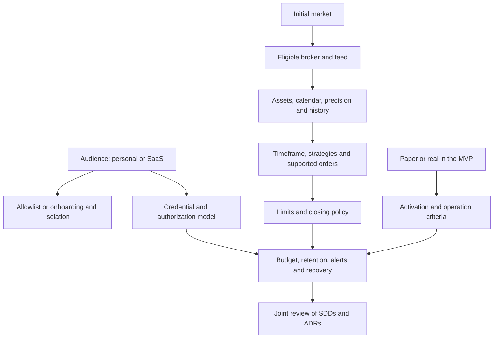

Status: rounds 1 and 2 answered; Q7–Q9 were not answered individually.
The later instruction to implement everything without interruptions delegated implementation
choices. Defaults adopted are in ADR-0011 and in the ROADMAP; they are not invented answers
from the owner. Implementation started under that authorization. No pre-selected option is accepted. The document remains a draft until there is shared understanding.

## Method

Ask only decisions whose prerequisites are resolved. Give a recommendation and phrase the question so that "yes" accepts it. Facts about tools,
code and providers are researched, not delegated to the user. Do not implement
choices still open; requested documentation may advance with clear states.

## Decisions already established

Go/Vukem + Inertia/React/Tailwind/PostgreSQL; `/` as dashboard; Google as the
only login; visitor goes to `/login`; shadcn/ui sidebar; Railway.

## Round 1 — answered

**Q1 — Audience:** can we start as a personal terminal, restricted to the owner's Google account?
Recommendation: yes, personal in the MVP. Alternative: SaaS from the start. Answer: **personal use confirmed**.

**Q2 — Market:** can we start with US stocks only? Recommendation:
yes, one market. Alternatives: B3, crypto, Brazil + US. Answer: **Brazil and US confirmed**.

**Q3 — Mode:** can we start with only backtesting and paper trading? Recommendation:
yes; real trading comes in a later phase. Answer: **backtesting and paper confirmed**.

## Dependency tree

## Round 2 — answered

**Q4 — US:** can we use Alpaca Paper as the first integration, with a replaceable adapter?
Recommendation: yes. Alternatives: IBKR or choose later.
Answer: **Alpaca Paper confirmed for the US**.

**Q5 — B3:** can we start with backtest and an internal simulator, and connect an external paper
account later after proving an API? Recommendation: yes. Alternative: require
integration with a B3 broker in the MVP. Answer: **B3 internal simulator confirmed**.

**Q6 — Access:** can we allow one Google account, initially authorized by verified
email and later bound to the stable subject? Recommendation: yes,
no public sign-up. Alternative: other accounts by invitation. Answer: **one authorized Google account confirmed**.

The internal simulator uses fictitious money and its own fill model; it cannot be labeled as broker
execution. The B3 data source remains open even with the internal simulator
already accepted in Q5.

## Round 3 — current frontier

**Q7 — Assets:** can we start with spot stocks, long-only without leverage,
watchlist PETR4, VALE3, ITUB4, AAPL, NVDA and TSLA? Recommendation: yes, configurable;
options, futures and crypto outside the MVP. Answer: **pending**.

**Q8 — Data:** can we use IEX/Alpaca in the US and import historical B3 candles
via CSV with provenance/license? B3 initially historical replay; real time
requires its own provider. Recommendation: yes. Answer: **pending**.

**Q9 — Time:** can we use closed 5-minute candles, regular session and
planned closing before the close? Recommendation: yes, respecting the
calendars of both markets. Answer: **pending**.

## Following rounds, not yet sent

After Q1: owner authorized by identity, invitations, recovery, isolation per account,
access profiles and eventual monetization.
After Q2: broker, available data, feed budget, asset universe,
currency and sessions. Only after that: strategies, frequencies and order types.
After Q3: definition of paper, need for an external broker, live gates,
reconciliation, supervision and risk blocks.
After these choices: numeric limits, no overnight positions, session closing,
handling of disconnections, alerts and authority to resume.
Finally: retention, RPO/RTO, availability, Railway budget, schedule and
acceptance of the implementation plan.

## Answer log

| Round | Decision | Answer | Impact |
| --- | --- | --- | --- |
| 1 | Audience | Personal | No SaaS in the MVP; owner authorization mandatory |
| 1 | Market | Brazil + US | Two calendars/currencies; adapters defined in round 2 |
| 1 | Execution | Backtest + paper | Real capital outside the MVP |
| 2 | US broker | Alpaca Paper | External paper adapter confirmed |
| 2 | B3 simulation | Internal initially | Do not promise external B3 orders |
| 2 | Google admission | One authorized account | Verified bootstrap email + stable subject |
| 3 | Universe and direction | Pending | Precision, capabilities and exposure |
| 3 | Feeds and history | Pending | IEX and B3 CSV are proposals |
| 3 | Frequency/session | Pending | Strategies and calendars |

The interview is not finished yet. Dates in documents do not replace acceptances.
