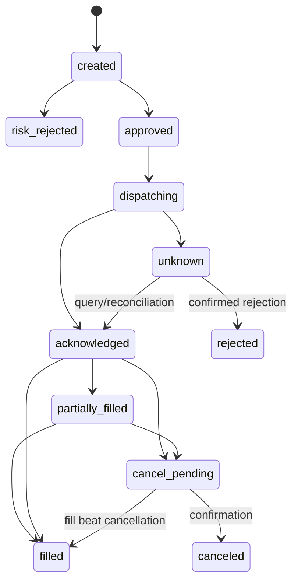

> Current implementation and explicit deviations are in the [ROADMAP](https://github.com/AlexGalhardo/vukem-trading/blob/main/ROADMAP.md)
> and [ADRs 0011–0013](/docs/adrs/index). Local technical acceptance is distinct
> from real OAuth/broker, Railway publication and prolonged financial observation.

Status: paper-only execution confirmed; design proposed, numeric limits and order types pending.

## Invariants

Every intent goes through risk, including future administrative controls.
Sum executed, partial, reserved and ambiguous exposure. Position/cash come from
reconciled fills and identified snapshots. Do not create new exposure if the account,
feed, calendar or order state is not reliable. Never allow the backtest's fictitious balance
as the balance of a paper/live account.

## Risk policy

The version includes risk per trade, daily loss, total/per-asset exposure, number of
positions/orders, volume/liquidity limit, maximum price age, session,
slippage and closing rule. Initial values are not approved.
Daily loss: define the base equity and the inclusion of unrealized P&L in the risk
round; the conservative recommendation is to include both and costs, with no reset on restart.
Risk is recalculated within the transaction that creates the reservation/intent/outbox.

Long-only, no leverage and limit orders are candidates, not decisions. Exits
require their own policy: do not reject risk reduction merely due to a limit on new
entries; also do not allow a duplicate exit to open an inverse position.

## States

Proposed internal states: `created`, `risk_rejected`, `approved`, `dispatching`,
`unknown`, `acknowledged`, `partially_filled`, `filled`, `cancel_pending`,
`canceled`, `rejected`, `expired`. A partial fill may coexist with cancellation;
model the executed quantity separately from the status. The adapter maps external states
without losing their original value. Out-of-order events do not regress blindly.

The diagram does not exhaust all states; rejection/expiration are possible according to the
broker's contract. The absence of an order in a query does not prove immediate rejection:
consider delay and provider consistency, keep quarantine and reconcile.

## Idempotency and reconciliation

Generate a unique key per account, strategy, version, signal and action. Persist
`client_order_id` before the external call. After a timeout, look up that ID and the
orders/fills before any retry. Do not generate a new ID for the same send.
The adapter must declare what happens when an ID is resubmitted and for how long
the query is reliable. Without sufficient proof, keep `unknown` and block.

Execution ingestion via stream + periodic reconciliation/API; persistent cursor
and deduplicated overlap. The external source confirms orders/positions; the local ledger
preserves the trail. Divergence creates an incident and a block until a recorded resolution.

## Emergency

`halt_new_orders` persists the block and increments the generation; it does not depend on the engine
being healthy to record it. `cancel_open_orders` tracks responses and fills in
flight. `flatten_positions` is a separate command with explicit confirmation, recent
observation and protection against reversal. The dashboard shows blocked, cancelling,
flattening or pending; it does not display "everything closed" merely because a click occurred.
The button does not guarantee execution during a broker/market failure or when the market is closed.

## Acceptance

Run the failure matrix of `../validation.md`. Restart loads blocks,
reconciles and only then operates. Test concurrency and deploy overlap. Closing the
browser does not interrupt monitoring. No UI command calls the broker outside
this path. A live adapter is not enabled by simply editing the URL in the proposed MVP
paper: validate mode and host at boot.
